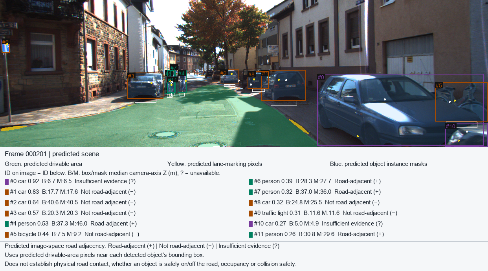

# Perception Stack for Autonomous Navigation

This project combines object detection, instance segmentation, monocular depth estimation, and road/lane segmentation into one perception pipeline. Given a driving image, it produces an annotated scene and object-level depth estimates. I also compared bounding-box and instance-mask depth sampling using KITTI annotations and sparse LiDAR measurements.



*Camera-only predictions on a KITTI Object frame. The green area is a predicted drivable mask; object labels describe image-space evidence, not physical road contact. KITTI image content is shared for noncommercial research under [CC BY-NC-SA 3.0](https://www.cvlibs.net/datasets/kitti/).*

## What it does

Three pretrained models process the same RGB image:

| Branch | Model | Output |
| --- | --- | --- |
| Objects | YOLO11n-seg | Detection boxes and instance masks |
| Depth | Depth Anything V2 Metric VKITTI Small | Predicted camera-axis surface depth in meters |
| Road and lanes | TwinLiteNetPlus Small | Separate predicted drivable-area and lane-marking masks |

The adapters restore all predictions to the original image size. The pipeline takes median predicted depth from each object's box and mask, checks a fixed image band below the box for predicted drivable pixels, and writes a scene JSON file and overlay. It keeps insufficient road evidence as an unknown state. Source fingerprints prevent a road mask or detector instance mask from being paired silently with stale object results. [The architecture figure](docs/figures/architecture.png) shows the camera pipeline and its separate evaluation path.

LiDAR is **only an evaluation sensor** here. Normal inference needs one camera image and the three model checkpoints.

## Setup

The validated baseline is Windows, Python 3.11, and CPU PyTorch. `pyproject.toml` declares the package; `requirements-win-py311.lock` pins the tested Windows environment. From the repository root in PowerShell:

```powershell
py -3.11 -m venv .venv
.\.venv\Scripts\python.exe -m pip install -r requirements-win-py311.lock
.\.venv\Scripts\python.exe -m pip install -e . --no-deps
.\.venv\Scripts\python.exe -m pytest -q
```

No dataset, model weight, or user image is bundled. Place these separately obtained checkpoint files in `models/` before inference:

- `yolo11n-seg.pt`
- `depth_anything_v2_metric_vkitti_vits.pth`
- `twinlitenetplus_bdd100k_small.pth`

The repository pins their expected hashes in `configs/demo_hardening/assets.json`. `scripts/download_assets.py --all` is an optional asset helper; it downloads the three checkpoints and an Ultralytics example image after you decide to use their source and license terms. Setup and saved-result inspection do not invoke it. [References and notices](REFERENCES.md) identify the model sources and the distinct terms for code, weights, and KITTI data.

## Run one image

Supply your own image path. This command uses the verified `perception_stack.scene_cli` arguments and writes to the ignored `outputs/` directory:

```powershell
$image = 'path\to\your_driving_image.png'
.\.venv\Scripts\python.exe -m perception_stack.scene_cli `
  --input $image `
  --device cpu `
  --json outputs\example_scene.json `
  --overlay outputs\example_overlay.png `
  --association-json outputs\example_road_association.json
```

The JSON contains object classes, boxes, box/mask depth summaries, provenance, and qualified road evidence. The overlay shows predictions on the original image. The association JSON records the fixed road-mask checks. Optional `--drivable-mask` and `--lane-mask` paths save the two binary masks. A metric camera X-Z plot is written only when a verified rectified pinhole calibration is supplied with `--intrinsics-json`; raw KITTI `P2` is not that input. No calibration is inferred for an arbitrary image.

## View or reproduce results

The small [figures](docs/figures/) and [result tables](results/) are a public snapshot; the complete local audit archive, raw KITTI data, dense predictions, and checkpoints are outside this repository. Viewing the snapshot needs no dataset. The chart command below reads the two compact paired CSVs and saved summary records, checks their published statistics, and writes new charts to a fresh ignored folder without model inference:

```powershell
.\.venv\Scripts\python.exe scripts\reproduce_public_results.py --check-only
.\.venv\Scripts\python.exe scripts\reproduce_public_results.py --output-dir outputs\public_results_reproduced
```

| Task | Entry point | Additional inputs | Output |
| --- | --- | --- | --- |
| View saved evidence | `docs/figures/`, `results/` | None | Figures and compact tables |
| Recalculate statistics and charts | `scripts/reproduce_public_results.py` | Included result tables; installed package dependencies | New files under `outputs/` |
| Run a camera-only scene | `python -m perception_stack.scene_cli` | One image and three checkpoints | Scene JSON, overlay, association JSON |
| Rerun KITTI evaluations | `python -m perception_stack.kitti_eval_cli` and the M5-L3 research scripts | Official Object images, labels, calibration, matching Velodyne scans, checkpoints, frozen split | New evaluation records in an isolated workspace |

[Reproducing results](docs/REPRODUCING_RESULTS.md) gives the verified order and explains where the full LiDAR scripts still require an isolated workspace and local archive paths. Do not refreeze the accepted split or run those scripts over preserved output folders.

## Results

These are **two different reference definitions**, so their errors should not be pooled or compared as a before/after change.

| Held-out study | Paired objects | Reference Z | Box MAE | Mask MAE |
| --- | ---: | --- | ---: | ---: |
| Original M5 | 785 | Annotated 3D-box bottom-center camera Z | 3.703 m | 3.837 m |
| Sparse LiDAR | 780 of 785 supported | Median eligible LiDAR object-surface camera-2 Z | 4.497 m | 4.642 m |

In the sparse-LiDAR study, box sampling has the lower **object-weighted** mean absolute error. The mean mask-minus-box absolute-error difference is +0.146 m, with a drive-cluster 95% interval of [+0.036,+0.236] m across 57 contributing drives. Masks nevertheless have lower error on about 59% of supported pairs; equal weighting of drives reverses the mean difference to -0.080 m. These findings depend on the reference, eligibility, and weighting. [The short project report](docs/PROJECT_REPORT.md) explains the methods and interpretation; [the provenance manifest](docs/PUBLIC_ARTIFACTS.md) identifies every copied figure and numerical source.

## Limits and acknowledgment

This is a research perception pipeline, not a real-time driving system. Predicted image-space road adjacency is not physical road membership or a safety judgment. Sparse, annotation-gated LiDAR is not dense RGB-visible-surface ground truth. The split is frame-disjoint but overlaps Raw drives; drive clustering cannot remove development exposure. Reconstructed detector boxes in the LiDAR analysis have an additional provenance limit. See the report for details.

This project was inspired by [Project 3, “Einstein Vision,”](https://rbe549.github.io/spring2023/proj/p3/) from Worcester Polytechnic Institute's RBE/CS 549 Computer Vision course, taught by Prof. Nitin J. Sanket. This implementation focuses on object detection, depth, and road/lane segmentation, with separate evaluation using KITTI annotations and LiDAR. It is not presented as an assessed course submission or an implementation of every assignment feature.
