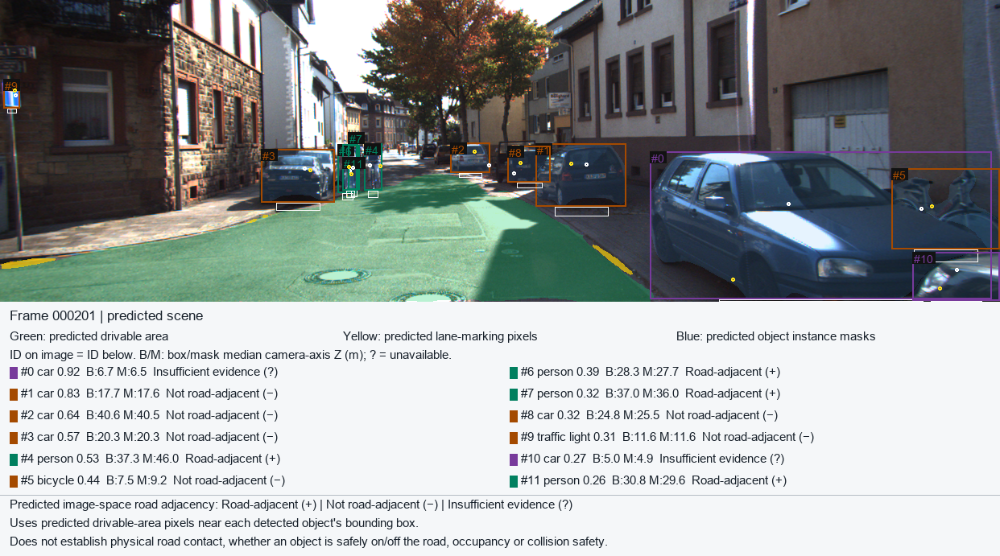
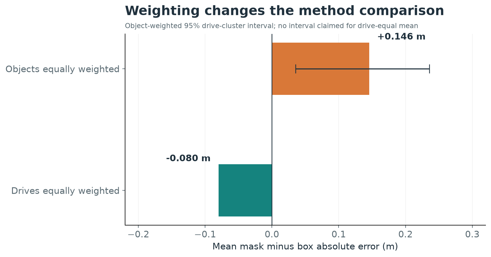

# Perception Stack for Autonomous Navigation

## 1. Objective

The goal is to combine three camera-based perception tasks in one reproducible pipeline: identify and segment objects, estimate monocular scene depth, and mark predicted drivable-road and lane pixels. Given one forward-facing RGB image, the implementation produces an annotated view and an object-level record containing class, detection box, instance mask identity, regional depth estimates, and image-space road evidence. It is a perception demonstration and evaluation system, not a vehicle controller.

The central evaluation question is whether sampling predicted depth inside an object instance mask improves an object's representative depth over sampling the enclosing detection box. Both methods use the same detections, depth map, matched reference objects, and frozen sampling rules. We tested them against two different KITTI depth targets. The first is the annotated 3D box's bottom-center camera Z. The second is a common sparse LiDAR object-surface camera-2 Z reference. They answer related but distinct questions; neither supplies dense visible-surface ground truth.

## 2. Introduction

Object recognition, depth, and road segmentation are useful together only if their outputs refer to the same image. A detector can find a car while a depth model predicts distances at pixels and a road model labels nearby pavement. Combining those results creates a more interpretable object record, but it also introduces alignment, source-consistency, and uncertainty problems. A visually plausible overlay can hide a stale mask, a mismatched calibration, or an unsupported depth estimate. The project therefore treats geometry and provenance as part of the implementation rather than presentation details.

The work was inspired by [Project 3, “Einstein Vision,”](https://rbe549.github.io/spring2023/proj/p3/) from Worcester Polytechnic Institute's RBE/CS 549 Computer Vision course, taught by Prof. Nitin J. Sanket. The assignment motivates interpretable driving-scene visualization. This independent implementation focuses on detection, depth, and road/lane segmentation, then adds fixed KITTI evaluations. It does not reproduce every assignment feature or claim to be a course submission.

*Figure 1. A crowded KITTI Object scene with predicted detections, depth summaries, instance masks, road and lane masks, and predicted image-space road-adjacency labels. KITTI image content is licensed CC BY-NC-SA 3.0. Negative or unknown road evidence does not establish physical off-road status.*

## 3. Methodology

**Camera pipeline.** YOLO11n-seg supplies object classes, boxes, and full-resolution instance masks. Depth Anything V2 Metric VKITTI Small predicts an approximate metric visible-surface depth image. TwinLiteNetPlus Small predicts separate binary drivable-area and lane-marking masks. Each adapter maps its output back to the original RGB image dimensions. Pixel coordinates use rightward `u` and downward `v`; masks are indexed `[v,u]`; boxes have exclusive right and bottom edges. The CPU implementation is the validated baseline. The networks are pretrained components; this project did not train or retune them.

For each detection, the M4 fusion step computes a median predicted camera-axis Z over valid pixels in the box and separately over valid pixels in `instance mask AND box`. The same finite-positive depth rule and acceptance thresholds apply to both methods. A missing or insufficient mask stays unavailable rather than being replaced with a box estimate. The median reduces sensitivity to isolated pixel errors, but a box can mix object and background, while a mask can miss object pixels or include another surface. Neither region is guaranteed to approximate a 3D box reference point. A selected pixel can be backprojected to an approximate surface point only with verified rectified intrinsics; the uncalibrated example is not assigned invented 3D coordinates.

The M6 scene layer uses a fixed central band below each detection box to test overlap with the **predicted** drivable mask. It reports positive, negative, or insufficient image-space evidence, carrying image-boundary uncertainty forward. This does not locate tires, infer ground contact, classify physical road occupancy, or make a safety decision. The road and detector provenance checks separately bind masks, boxes, and instance-mask pixels to the scene so old outputs cannot be silently paired with a new image. The [architecture diagram](figures/architecture.png) separates these RGB inference branches from the evaluation-only KITTI annotation and LiDAR branches.

**Frozen annotated-reference evaluation.** The original M5 protocol selected 256 held-out frames from the labeled KITTI Object training partition using a frozen split manifest. Conservative Car and Pedestrian mappings and one-to-one 2D IoU matching at 0.50 produced 785 matched object pairs. The fixed M4 medians were compared with the KITTI 3D label's bottom-center `location.z` in rectified camera coordinates. This target is an object annotation, not the RGB-visible surface at the pixels being sampled. Absolute error, signed error, paired mask-minus-box difference, and a frame bootstrap were recorded without fitting scale on test labels.

**Sparse LiDAR evaluation.** Matching official KITTI Object Velodyne scans were verified for the original frame IDs. Calibration bytes were hashed and parsed together. A measured point is transformed with `R0_rect · Tr_velo_to_cam`, projected through the full translated `P2`, and expressed as camera-2 axial Z. A global nearest-return z-buffer resolves observed same-pixel conflicts. The fixed association then requires containment in the annotated oriented 3D cuboid and both the annotation and matched detector 2D boxes; competing cuboids are excluded. Predicted instance masks do not gate the reference, preserving a common measured target for box and mask comparisons. An object needs at least three distinct accepted image-pixel bins; its sparse reference is their median Z. The measured returns remain a sparse, annotation-gated surface proxy because LiDAR and RGB viewpoints differ and not every occlusion is observed.

The 16-frame pilot checked calibration, alignment, and support before the held-out run. The final LiDAR analysis reused all 785 frozen M5 match identities and depth medians on 256 held-out frames. Five objects with one or two accepted bins remain in coverage but have no primary sparse reference. The 780 supported pairs span 57 mapped Raw drives. Paired uncertainty uses 1,000 drive-cluster bootstrap draws with seed 549; an equal-drive weighting is reported as a separate sensitivity. The frame split was not drive-disjoint: 34 development drives overlap held-out, including ten pilot drives. Grouped resampling cannot remove this development exposure.

## 4. Results

| Held-out comparison | Paired objects | Reference Z | Box MAE | Mask MAE | Mean mask-minus-box absolute error |
| --- | ---: | --- | ---: | ---: | ---: |
| Original M5 | 785 | Annotated 3D-box bottom-center camera Z | 3.703 m | 3.837 m | +0.134 m |
| Sparse LiDAR | 780 supported of 785 | Median eligible object-surface camera-2 Z | 4.497 m | 4.642 m | +0.146 m |

For the original annotated reference, the frame-bootstrap 95% interval for the mean paired difference is approximately [+0.060,+0.215] m. Against the sparse LiDAR reference, box and mask RMSE are 6.150 and 6.376 m. The 95% drive-cluster interval for the **object-weighted** mean paired difference is [+0.036,+0.236] m. The two MAEs in each row share a reference and eligible population; errors across rows must not be subtracted as if the LiDAR study were a before/after change in model accuracy.

The LiDAR comparison has an important aggregation dependence. Masks have lower absolute error on approximately 59% of supported pairs, but a minority of larger mask disadvantages outweigh many smaller wins, leaving box sampling with slightly lower object-weighted mean error. Weighting each contributing drive equally changes the mean mask-minus-box difference to -0.080 m. Object weighting describes the sampled matched-object population; drive-equal weighting describes a typical contributing drive. The drive-cluster interval above applies to the former, not the latter. Thus the observed result is specific to the reference, support rule, split, and weighting; it is not a universal ranking of boxes and masks.

*Figure 2. The mean paired difference changes sign when drives receive equal weight. Bars summarize saved held-out pairs; neither bar is an independent road-safety or generalization measure.*

### Diagnostic examples and interpretation

| Object example | Accepted bins | Observation and limitation |
| --- | ---: | --- |
| 007119, reference 3 | 3 | Sparse Z about 57.978 m; just meets the frozen support rule. |
| 007111, reference 0 | 2,442 | Sparse Z about 8.906 m; abundant returns do not identify the exact RGB-visible face. |
| 001010, reference 11 | 1 | Unsupported; excluded from primary paired-error arithmetic. |
| 006262, reference 8 | Supported | Sparse Z about 27.356 m; box/mask predictions about 38.007/50.188 m in a crowded view. |
| 007165, reference 3 | Supported | Both predictions about 74.85 m versus sparse Z about 46.73 m. |

These cases expose different limits. The three-bin object is eligible yet has little surface evidence; the well-supported object has many points but remains subject to viewpoint and annotation uncertainty. The one-bin object cannot be scored under the declared primary policy. The crowded case shows a large mask disadvantage, but overlap alone does not prove the mask caused it; the underlying mask and depth field need closer inspection. The large-error case shows that two sampling methods can agree with each other while both differ substantially from the measured proxy. Global same-pixel z-buffering handles observed conflicts, not every unseen RGB/LiDAR occlusion or transparent surface.

The sparse evaluation reconstructs detector box coordinates with the pinned detector because the original M5 frame records did not archive every box coordinate. Frozen class, confidence, match identity, and IoU checks agreed, and the reconstructed coordinates were saved, but these checks cannot independently prove exact historical box identity. The supplied official Object archive had matching structure, counts, local source metadata, CRCs, and per-file hashes; no publisher-signed checksum was available to authenticate its origin cryptographically. Those provenance limits remain visible in the full local records. A road mask may also miss occupied roadway, yielding a negative *predicted-adjacency* label for a vehicle that is visibly on the road. The system keeps such labels tied to the mask rule rather than treating them as physical classifications.

An engineering lesson is that a correct geometric transform and a clean-looking visualization are necessary checks, not proof that each measured point corresponds to the camera-visible surface. The annotation, projection, nearest-return, and two-box gates make the sparse reference explicit and repeatable, while leaving parallax and unobserved occlusion as limits. Similarly, source fingerprints detect stale local pairings but cannot authenticate a model's predictions or replace independent validation. These distinctions shaped the reporting: supported and unsupported objects share the coverage denominator, the two reference definitions are shown separately, and the weighting reversal is disclosed beside the primary mean.

The project demonstrates a reproducible camera perception integration and a bounded, auditable comparison of two fixed depth-sampling methods. Its result is scientifically useful partly because the seemingly simple “masks are better” hypothesis is not supported as a blanket claim. The data expose reference mismatch, support conditioning, drive dependence, and failure cases that a single average would obscure. The system does not establish dense visible-surface truth, physical road contact, real-time operation, or autonomous-driving safety. The public result tables preserve paired numerical records but not the full per-point source audit; full regeneration still needs separately obtained official data and checkpoints. Compact tables and copied figures are documented in the [artifact manifest](PUBLIC_ARTIFACTS.md); [reproduction instructions](REPRODUCING_RESULTS.md) separate viewing saved evidence from recomputation and full inference.
